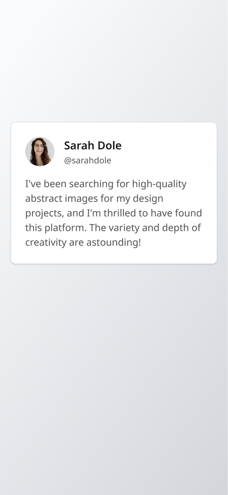
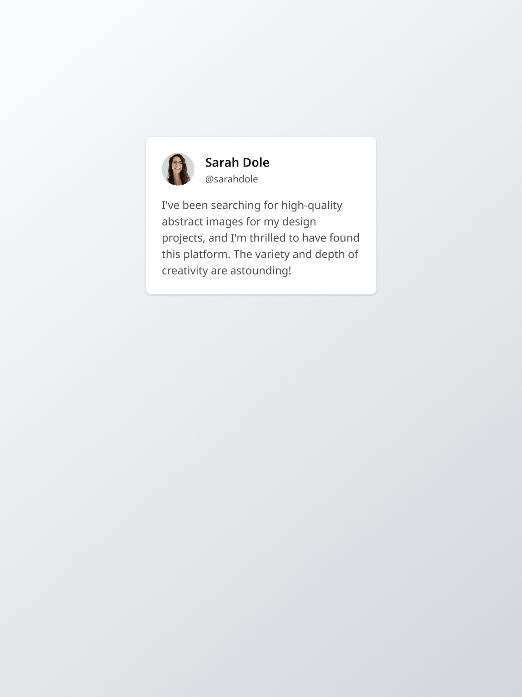
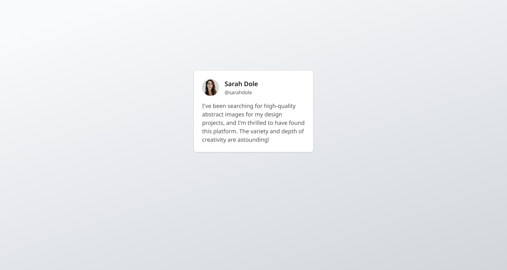

# Testimonial Card

My solution to the [GreatFrontEnd Projects](https://www.greatfrontend.com/projects) **Testimonial Card** challenge. It's a small, responsive card with a user's avatar, name, handle and a short testimonial, built to match the provided designs.

**Live:** https://isaiaslipa.github.io/Testimonial-Card/

## Built with

- Semantic HTML (`<article>`, `<header>`)
- [Tailwind CSS](https://tailwindcss.com/) via the Play CDN
- [Noto Sans](https://fonts.google.com/noto/specimen/Noto+Sans) from Google Fonts
- No JavaScript or build step

## Implementation notes

- The card is capped at `340px` wide and centered with flexbox.
- The testimonial uses `line-clamp-5`, so longer text truncates cleanly and doesn't break the card's height.
- Neutral color tokens (`neutral-900` / `neutral-600`) set the text hierarchy: name, handle, body.
- The avatar has descriptive `alt` text.

## Running locally

Open `index.html` in a browser. No install needed.

## Project structure

```
├── index.html          # Markup + Tailwind classes
├── css/style.css       # Base font, resets, credits footer
├── img/                # Avatar and favicon
└── designs/            # Reference designs (mobile, tablet, desktop)
```

## Reference designs

| Mobile | Tablet | Desktop |
| --- | --- | --- |
|  |  |  |
